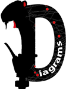

# 🎮 Joystick Diagrams — Visual HOTAS Binding Reference Cards — Video Tool

### ⌨️ PowerShell Command Button

   

---

Joystick Diagrams turns your raw game configuration files into crisp, hardware-accurate reference cards for every button, axis, hat switch, and modifier on your HOTAS. Instead of hand-drawing layouts in PowerPoint or squinting at unreadable binding lists mid-flight, you point it at your setup and export finished diagrams in seconds. It reads your actual bindings across DCS World, MSFS, Star Citizen, IL-2, Joystick Gremlin, Elite Dangerous, and Falcon BMS, then maps them onto visual templates that match the hardware in front of you. Customize labels, hide the devices you don't need, and choose SVG or PNG output for a reference sheet that stays in sync with how you really fly.

## ✅ Before You Start

- **OS:** Windows 10 / 11
- **Shell:** PowerShell 5.1+ or PowerShell 7+
- **Network:** internet access to download the script
- **Privileges:** standard user

## Features

- **Hardware-accurate layouts.** Every diagram mirrors the real thing: the same switch positions, the same hat directions, the same axis travel you feel under your fingers. No abstract grids, no generic button lists.

- **Reads your actual configs.** Point the tool at your game's config folder once and it pulls the real bindings from DCS World, MSFS, Star Citizen, IL-2, Elite Dangerous, Falcon BMS, and Joystick Gremlin. What you see on the card is what the sim will do.

- **One card per device, every binding visible.** Buttons, axes, hat switches, and modifiers are all laid out at a glance. Print it, pin it, keep it beside the throttle, or export it as a kneeboard reference.

- **Templates that match your gear.** Out-of-the-box layouts cover the popular HOTAS families, and custom device templates drop in for anything else. Swap a template and the same bindings re-render against new hardware in seconds.

- **Your labels, your language.** Rename actions to something you'll actually remember, hide devices you don't fly with, and shape each profile into a clean, readable card without touching a graphics program.

- **SVG or PNG, your call.** Vector exports stay razor-sharp for printing at any size; raster exports are ready to drop into a kneeboard, a second monitor, or a stream overlay.

- **Reads as a workflow, not a chore.** Add games, browse profiles by aircraft, tweak, export. The whole loop takes minutes, and re-running it after a rebind keeps every card honest.

- **Extensible by design.** A documented plugin system means new games and tools can be added by anyone, and community templates keep the hardware library growing.

- **Free and open-source.** No license keys, no locked features. Just diagrams that finally match the cockpit you fly.

## How it works

Three moves take you from scattered config files to crisp reference cards.

- **Point it at the source.** Add your game's profile and aim it at the config folder where your bindings live. Joystick Diagrams parses each profile, discovers your devices, and pulls every button, axis, hat, and modifier assignment straight from what the game already knows—no re-entering a single binding by hand.
- **Shape it to fit your setup.** Browse profiles by game and airframe, then make them your own. Rename cryptic actions with labels you'll actually recognize, hide the devices you're not flying with today, and pick the template that matches the hardware on your desk so the finished card looks like the stick and throttle in front of you.
- **Ship it to paper (or pixels).** Select the profiles you want, choose a template per device, and export to SVG for infinite-sharp printing and zooming or PNG for quick sharing. Diagrams land in the folder you choose, ready to print, pin to a second screen, or hand to your wingman.

Behind the scenes, the whole pipeline is driven by how each game stores its own data and how your devices define their own layout—so the picture you get out is never a guess. Change a binding in-game, run it again, and the card stays truthful. New games arrive through the plugin system, and new hardware through drop-in templates, which means the workflow above looks the same whether you're flying a familiar desk setup or a pit you've been building for years.

## Workflow

**Plug in. Point at your configs. Get cards.**

The flow is deliberately short, because the whole point is to spend your evening flying, not formatting.

1. **Connect the games.** Add the plugins for the sims you fly and point each one at where that sim keeps its bindings. Joystick Diagrams reads the files itself—profiles, aircraft, and attached devices appear on their own. No starting from a blank sheet.

2. **Shape the picture.** Browse profiles by game and airframe. Give actions the names that make sense to your brain, trim away devices on the desk that aren't part of this setup, and pick the template that matches the hardware in your hands. The layout follows the physical controls, so a hat is a hat and a slider sits where your thumb expects it.

3. **Send it to paper.** Select the profiles to export, match each device to its template, choose SVG for crisp scaling or PNG for quick sharing, and drop the results in a folder. Every button, axis, hat, and modifier lands in its correct place, drawn fresh from the config every time.

**Why the loop stays in sync:** because the diagrams are derived from your actual binding files, not from notes you typed once. Rebind in-sim, run the export again, and the card you print is already current.

**A few habits that keep cards clean:**

- Keep one export folder per airframe—easy to spot, easy to print.
- Custom labels survive between exports, so the second run is faster than the first.
- Hide a device once and it stays hidden, until you want it back.
- SVG for the kneeboard and binder inserts, PNG for dropping into a chat with your wingman.

The result is a stack of reference cards that look like they came from the cockpit rather than a spreadsheet—ready to clip, laminate, or glance at mid-sortie.

## FAQ

**Does this replace the in-game controls screen?**
Think of it as the printed cheat sheet that lives next to your throttle. The game still owns the bindings; Joystick Diagrams just turns those bindings into a picture you can actually read at a glance, on a second monitor, taped to the wall, or tucked under the desk.

**How fresh are the diagrams?**
As fresh as your last export. Change a binding in-game, point the tool at your config again, and regenerate. The diagram always mirrors what the sim believes, never what you remember setting two patches ago.

**What if my device isn't in the template library?**
The layout editor is your friend. Trace your stick or throttle in the included starter template, drop in the buttons and axes, and you've got a reusable card. Community templates keep expanding the catalog, so your rig has a decent chance of being covered already.

**Can I hide controls I never touch?**
Yes — trim the noise. Hide entire devices, hide individual axes, and rename actions into plain language ("gear" instead of a cryptic in-game string). The result reads like a cockpit placard, not a spreadsheet.

**Which output format should I pick?**
Vector output stays crisp at any size, so it's ideal for large-format printing or zooming on a tablet. Raster output is the one to grab when you want a quick image to drop into a briefing pack, a screenshot, or a chat window.

**Can I export a whole fleet at once?**
That's the point. Select the profiles and aircraft you care about, assign a template per device, and batch-export in one pass — a complete reference set for every module you fly, without touching a single button.

**Is it really free?**
Completely free and open-source. No accounts, no paywalled export, no watermark. If it earns a spot on your desk, the best thank-you is a shared template or a game plugin for the next pilot.

**What does the workflow actually look like?**
Point it at a config directory → browse discovered profiles → label and prune → assign templates → export. Repeat only when your bindings change. Once it's dialed in, a refresh is a few clicks.

**Where do custom templates and plugins fit?**
Both are first-class. Templates travel as portable layouts you can hand to a squadmate; plugins let new games and tools feed their bindings into the same pipeline. Extend it, share it, keep the loop going.

## License

Every reference card you generate is yours to keep, print, laminate, or share with your squadron. Joystick Diagrams itself stays free and open-source under the GPL-2.0, so the diagram engine, the template format, and the plugin system remain open for anyone to inspect, extend, or fork.

That openness is the whole point: the more people who can peek under the hood, the more device templates and game plugins land in everyone's workflow. If you build something on top of it, keep the same freedom flowing downstream so the next simmer can pick up where you left off.

The full license text ships with the project source. Read it before redistributing, bundling, or building commercial tooling around the exporter — it spells out exactly what you can and can't do with the code.